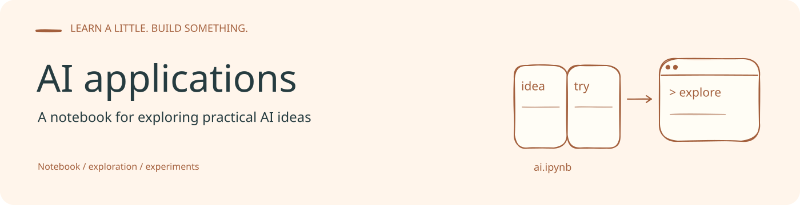
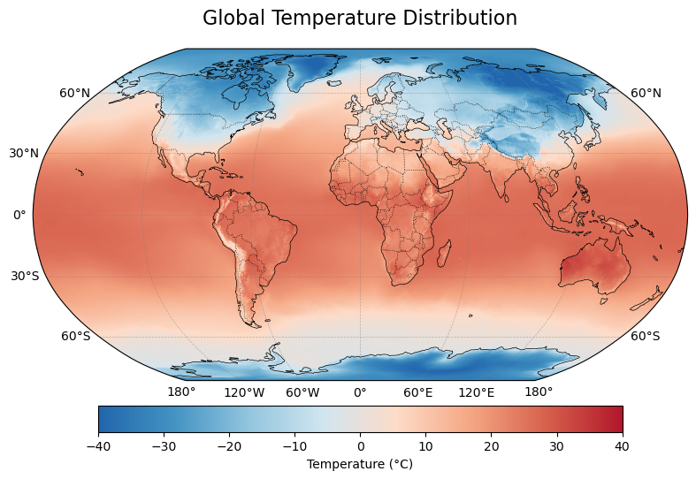

# AI_application

面向地学分析的 Notebook 案例集。本地工作区的 `ai.ipynb` 包含三个探索方向：地图绘制、径流时间序列的收敛交叉映射（CCM），以及回归散点图。

## 案例

| 案例 | 内容 | 主要依赖 |
| --- | --- | --- |
| 地图绘制 | 使用 Robinson 投影、陆地要素、经纬网和色标展示空间数据 | xarray、Cartopy、Matplotlib |
| 径流分析 | 读取 `machine_l.csv`，探索降水、蒸散发与径流的 CCM 关系 | pandas、pyEDM |
| 统计绘图 | 绘制散点与回归拟合 | pandas、NumPy、Matplotlib、seaborn |

## 当前状态

本轮盘点时 GitHub 仓库为空，源码与输入数据位于本地工作区。它们尚未在指定的 dot 环境重新执行；运行入口、数据范围和结果图将在验证后补齐。

这里的案例是探索性分析，不应将 Notebook 中的初步相关关系直接解释为已验证的科学结论。

条幅源文件：[Excalidraw](assets/readme/banner.excalidraw)。

<!-- readme-visual-refresh:result -->
## Saved project output

Existing ERA5 monthly-temperature visualization saved in ai.ipynb.

Historical project output, retained from the existing working files; it was not rerun for this documentation update.

Source: `ai.ipynb [zero-based cell 3, output 0]`.
<!-- /readme-visual-refresh:result -->
